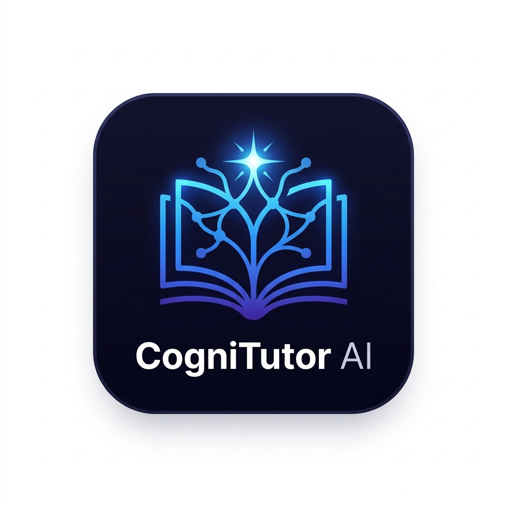
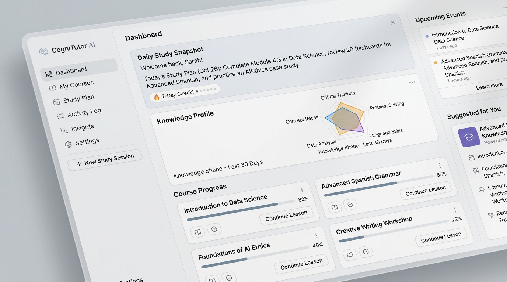
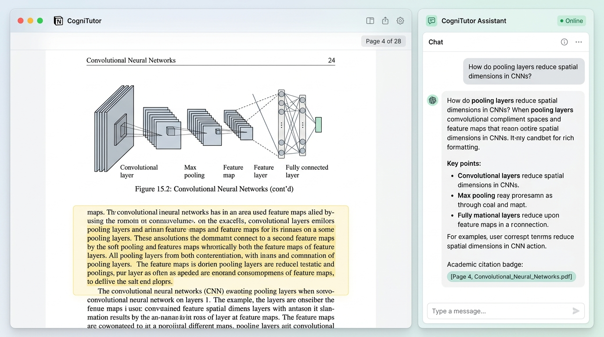
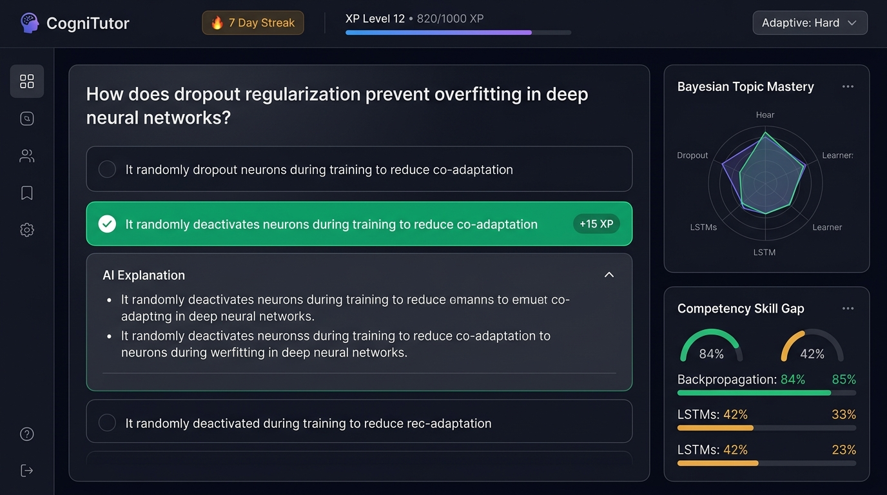
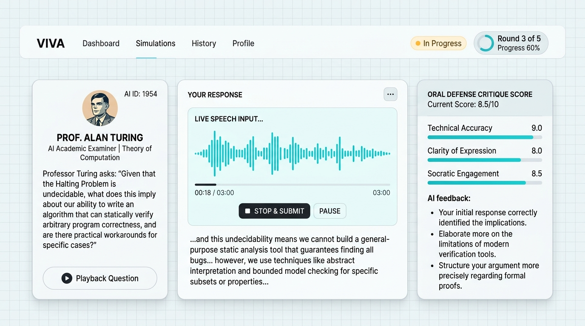
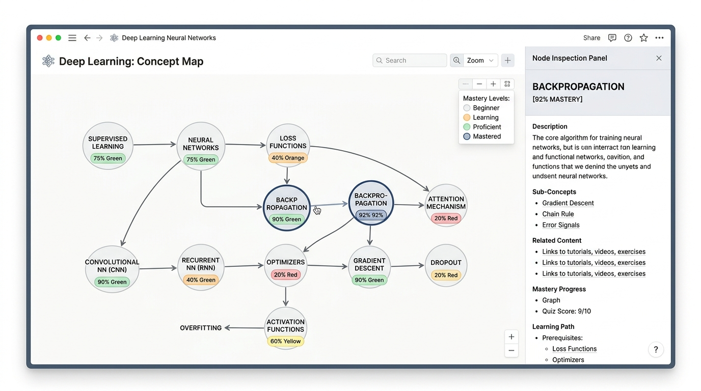
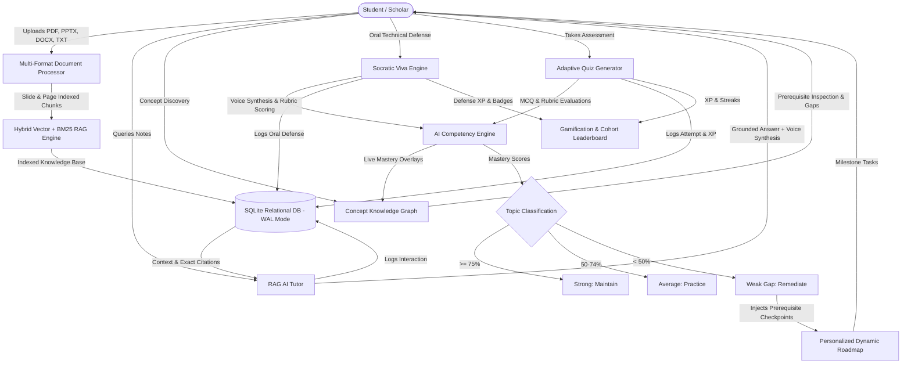

<p align="center">
  
</p>

<h1 align="center">CogniTutor AI</h1>

<p align="center">
  <strong>Your Personal AI Learning Copilot & Adaptive Socratic Tutor</strong><br>
  <em>Turn any PDF, PowerPoint (PPTX), Word Doc (DOCX), or Text file into an interactive personalized learning ecosystem.</em>
</p>

<p align="center">
  <a href="https://cognitutor-ai-platform.onrender.com">
    
  </a>
  <a href="https://cognitutor-ai-platform.onrender.com">
    
  </a>
  <a href="test_platform.py">
    
  </a>
</p>

<p align="center">
  
  
  
  
  
  
</p>

---

## 🌐 Public Live Access

Experience CogniTutor AI live on the web with full persistent storage, RAG Q&A, and voice viva examination:

> 🔗 **Live Web Application**: **[https://cognitutor-ai-platform.onrender.com](https://cognitutor-ai-platform.onrender.com)**  
> 💻 **Local Server**: [http://127.0.0.1:8000](http://127.0.0.1:8000)

*Runs 24/7 in the cloud on Render. Accessible from any smartphone, tablet, or desktop browser with zero installation.*

---

## 🌟 Overview

**CogniTutor AI** is a production-grade personal tutoring platform designed to solve the passive learning trap. Instead of simply generating generic answers, CogniTutor reads your uploaded course notes, diagnoses what you know versus where your skill gaps lie, dynamically adapts test questions, presents visual prerequisite knowledge graphs, conducts oral technical viva examinations with voice synthesis, and preserves all learning metrics in a persistent SQLite relational database.

Built with an authentic **Notion / NotebookLM** human-crafted design system—free from sci-fi glowing purple neon tropes—focused entirely on clarity, deep conceptual retention, and academic rigor.

---

## 📸 Visual Showcase

### 1. Daily Study Snapshot & Knowledge Mastery Dashboard
*Track Bayesian topic mastery, review daily study snapshots, monitor 7-day study streaks, inspect radar knowledge shape profiles, and view real-time database health.*
<p align="center">
  
</p>

---

### 2. Split-Screen PDF Viewer with Grounded Bounding-Box Citations
*Integrated PDF.js split-screen viewer side-by-side with AI Tutor chat. Clicking any citation opens the original document at the exact page, scrolls smoothly to the target excerpt, and pulses an interactive bounding-box highlight overlay.*
<p align="center">
  
</p>

---

### 3. Adaptive Practice Quiz & Competency Skill Gap Analyzer
*Computerized Adaptive Testing (CAT) that scales question difficulty (`Easy ↔ Medium ↔ Hard`) based on live student performance and streaks. Instant rubric evaluation with XP gains and Bayesian topic mastery feedback.*
<p align="center">
  
</p>

---

### 4. Socratic Oral Viva Examination Mode
*Simulate a rigorous academic viva with **Prof. Alan Turing (AI Examiner)**. Test conceptual understanding with live speech recognition, voice question playback, multi-round follow-up inquiries, and instant oral defense scorecards.*
<p align="center">
  
</p>

---

### 5. Interactive Concept Knowledge Graph (Visual Ontology)
*Explore how concepts evolve, connect, and depend on each other. Nodes are dynamically color-coded with live competency scores (Emerald: Strong $\ge 75\%$, Amber: Average $50-74\%$, Rose: Weak Gap $< 50\%$).*
<p align="center">
  
</p>

---

## 🗄️ Persistent Relational Database Architecture

CogniTutor utilizes a zero-dependency, ACID-compliant **SQLite 3 database** with **Write-Ahead Logging (WAL)** and foreign key integrity located at `data/cognitutor.db`.

| Table | Description | Primary Key / Relations |
| :--- | :--- | :--- |
| `documents` | Preserves all uploaded & sample curriculum materials | `doc_id (PK)`, `file_name`, `file_size_kb`, `chunk_count`, `topics_json` |
| `chunks` | Stores all segmented text passages with foreign key integrity | `chunk_id (PK)`, `doc_id (FK)`, `text`, `topic`, `exact_citation` |
| `quiz_attempts` | Full history of student answers, difficulty levels, and XP | `attempt_id (PK)`, `question_id`, `topic`, `is_correct`, `difficulty`, `xp` |
| `student_profile` | Long-term mastery tracking, streaks, and unlocked badges | `user_id (PK)`, `name`, `xp`, `level`, `streak_days`, `badges_json` |
| `chat_history` | Persistent log of all AI Tutor interactions and citations | `message_id (PK)`, `session_id`, `query`, `answer`, `citations_json` |
| `viva_history` | Archives examiner questions, student defense transcripts & grades | `id (PK)`, `session_id`, `topic`, `student_defense`, `score`, `critique` |
| `roadmap_progress`| Tracks completion of individual personalized milestones | `milestone_id (PK)`, `completed`, `updated_at` |

*Includes built-in `/api/db/download` endpoint for 1-click database backups and offline inspection via DB Browser for SQLite.*

---

## ✨ Key Features

- **📑 Split-Screen PDF Viewer with Interactive Bounding-Box Citations**: Integrated PDF.js split-screen viewer side-by-side with chat. Clicking any citation opens the original document at the exact page, scrolls smoothly to the target excerpt, and pulses an interactive bounding-box highlight overlay (`@keyframes highlight-pulse`). Supports full zoom, target navigation, and non-PDF visual fallbacks.
- **⚡ Real-Time Token Streaming (Server-Sent Events / SSE)**: Word-by-word streaming responses powered by FastAPI `StreamingResponse` yielding asynchronous Server-Sent Events (`citations`, `token`, `done`) with live glowing cursor typewriter animation.
- **🧠 Hybrid Dense + Sparse Neural Reranking (BM25 + Dense Cosine + RRF)**: Combines Okapi BM25 ($k_1=1.5, b=0.75$) for exact technical terminology and acronyms (CNN, RNN, LSTM, SGD, BPTT) with subword dense cosine vector ranking, fused via Reciprocal Rank Fusion ($RRF(d) = \frac{1}{60 + \text{rank}_{BM25}} + \frac{1}{60 + \text{rank}_{Dense}}$) and cross-encoder phrase alignment scoring.
- **📚 Multi-Course Academic Support**: Seamlessly switch between and manage multiple subjects:
  - 🧠 *Deep Learning & Neural Networks* (Backprop, CNNs, LSTMs, Transformers)
  - 💻 *Data Structures & Algorithms* (Graph Traversals, Dynamic Programming, Trees)
  - 🖥️ *Operating Systems & Systems Programming* (Context Switching, CPU Scheduling, Deadlocks, Paging)
  - 📐 *Linear Algebra & Optimization* (Eigenvalues, SVD, Gradient Descent, Convexity)
- **📄 Multi-Format Document Processing**: Upload PDFs, PowerPoint presentations (`.pptx`), Word documents (`.docx`), or Plain Text (`.txt`, `.md`). Chunks preserve exact page and slide numbers for citation footnote links.
- **🔍 Grounded Hybrid RAG AI Tutor**: TF-IDF vector space model paired with BM25 keyword matching guarantees responses are grounded strictly in your study material with academic citation pills.
- **💡 3-Level Progressive Doubt Solver**: Explains complex topics across three levels of abstraction:
  - *Beginner*: Intuitive real-world analogies.
  - *Intermediate*: Technical mathematics & theoretical intuitions.
  - *Advanced*: Production-ready Python / PyTorch code implementations.
- **🎯 Computerized Adaptive Testing (CAT)**: Quizzes dynamically scale difficulty (`Easy ↔ Medium ↔ Hard`) based on live student performance and streaks.
- **📊 Bayesian Competency & Skill Gap Engine**: Automatically categorizes curriculum mastery into *Strong*, *Average*, and *Weak Gaps*.
- **🗺️ Dynamic Personalized Roadmap**: Automatically schedules study milestones and injects prerequisite remediation before unlocking advanced lessons.
- **🕸️ Concept Knowledge Graph (Visual Ontology)**: Interactive visual DAG of concept prerequisites with live mastery status, relationship labels, and an interactive inspection drawer.
- **🎙️ Socratic Oral Viva Mode**: Hands-free voice interview simulator with misconception detection and university-grade oral scorecards.
- **🗣️ Voice AI Tutor**: Built-in Web Speech API speech synthesis and speech-to-text recording.
- **🏆 Gamification & Cohort Leaderboard**: Earn XP, level up, unlock achievement badges, maintain streaks, and climb the cohort study leaderboard.

---

## 🏗️ System Architecture



---

## ⚡ Quickstart & Installation

### Prerequisites
- Python 3.11 or higher
- Modern Web Browser (Chrome, Edge, Safari, or Firefox)
- Git

### 1. Clone the Repository
```bash
git clone https://github.com/SyedZiyan/CogniTutor-AI-Learning-Platform.git
cd CogniTutor-AI-Learning-Platform
```

### 2. Create and Activate Virtual Environment
```bash
# Windows
python -m venv venv
venv\Scripts\activate

# macOS / Linux
python3 -m venv venv
source venv/bin/activate
```

### 3. Install Dependencies
```bash
pip install -r requirements.txt
```

### 4. Run the Application
```bash
python run.py
```
Open your browser and navigate to `http://127.0.0.1:8000`.

### 5. Run Verification Tests
```bash
python test_platform.py
```
*(All 13 automated unit, integration, and database test suites will execute and verify system health.)*

---

## 🔌 API Endpoints Reference

The backend provides **25 modular REST & SSE API endpoints**:

| Method | Endpoint | Description |
| :---: | :--- | :--- |
| `GET` | `/api/status` | System health, indexed files count, database status, and chunk stats |
| `GET` | `/api/db/stats` | Live SQLite metrics (size in KB, table row counts, WAL status) |
| `GET` | `/api/db/quiz-history` | Historical log of student quiz attempts and accuracy |
| `GET` | `/api/db/chat-history` | Previous conversation turns and grounding citations |
| `GET` | `/api/db/viva-history` | Complete oral defense transcripts and examiner verdicts |
| `GET` | `/api/db/download` | 1-click download of the complete `cognitutor.db` SQLite file |
| `GET` | `/api/documents` | Pre-loaded and uploaded materials library |
| `GET` | `/api/documents/{doc_id}/file` | Raw PDF / document byte streaming with Range requests for PDF.js |
| `GET` | `/api/documents/{doc_id}/chunks` | Inspect raw parsed chunks with page/slide metadata |
| `POST` | `/api/upload` | Upload new PDF, PPTX, DOCX, or TXT documents |
| `POST` | `/api/tutor/chat` | RAG Q&A grounded with exact citations and Hybrid RRF scores |
| `POST` | `/api/tutor/chat/stream` | Word-by-word real-time token streaming via Server-Sent Events (SSE) |
| `POST` | `/api/tutor/doubt-solver` | 3-Level Progressive Doubt Explainer (Analogy, Math, Code) |
| `GET` | `/api/quiz/generate` | Adaptive multi-tier quiz generation |
| `POST` | `/api/quiz/evaluate-mcq` | MCQ scoring with adaptive difficulty adjustment & XP |
| `POST` | `/api/quiz/evaluate-short` | Short answer evaluation against key concept rubrics |
| `GET` | `/api/competency/analysis` | Topic mastery breakdown (Strong, Average, Weak) |
| `GET` | `/api/roadmap` | Dynamic study roadmap with remediation milestones |
| `POST` | `/api/roadmap/milestone/{id}/toggle` | Check off study milestones and earn XP |
| `GET` | `/api/gamification` | XP, student levels, badge showcase, leaderboard |
| `POST` | `/api/gamification/badge/{id}/unlock` | Achievement badge unlocker |
| `POST` | `/api/settings` | Update LLM provider (Local / OpenAI / Gemini / Ollama) |
| `GET` | `/api/graph` | Concept Knowledge Graph with live competency overlay |
| `POST` | `/api/viva/start` | Start Socratic oral viva session with Prof. Turing |
| `POST` | `/api/viva/respond` | Submit oral defense transcript for rubric evaluation |

---

## 📂 Project Structure

```
CogniTutor-AI-Learning-Platform/
├── backend/
│   ├── config.py              # Configuration & environment settings
│   ├── database.py            # SQLite Relational Database Manager (WAL Mode)
│   ├── course_manager.py      # Multi-course switcher & catalog manager
│   ├── document_processor.py  # Multi-format document parser (PDF, PPTX, DOCX, TXT)
│   ├── storage.py             # Document store & SQLite chunk indexing
│   ├── rag_engine.py          # TF-IDF + BM25 hybrid retrieval engine
│   ├── tutor_engine.py        # RAG Q&A & 3-level doubt solver
│   ├── quiz_engine.py         # Adaptive quiz generator & rubric evaluators
│   ├── competency_engine.py   # Bayesian mastery & skill gap analysis
│   ├── roadmap_engine.py      # Dynamic roadmap with remediation checkpoints
│   ├── knowledge_graph.py     # Directed ontology graph & competency mapper
│   ├── viva_engine.py         # Socratic viva oral examination engine
│   ├── gamification.py        # XP, levels, badges, streaks, & leaderboard
│   ├── create_samples.py      # Preloaded course materials generator
│   └── main.py                # FastAPI application & route controllers
├── data/
│   ├── cognitutor.db          # Persistent SQLite database file
│   └── documents_metadata.json# Synchronized document metadata cache
├── frontend/
│   ├── assets/                # Brand logo & SVG favicons
│   ├── css/
│   │   └── style.css          # Clean Notion/Linear light design system
│   ├── js/
│   │   ├── api.js             # Client API SDK
│   │   ├── charts.js          # Chart.js radar & progress visualizers
│   │   ├── voice.js           # Web Speech API speech synthesis & recognition
│   │   └── app.js             # Main SPA application controller
│   └── index.html             # Single Page Application
├── docs/
│   └── images/                # Visual previews, screenshots, & brand marks
│       ├── logo.png
│       ├── dashboard_preview.png
│       ├── split_screen_citations.png
│       ├── adaptive_quiz_preview.png
│       ├── viva_interview_preview.png
│       └── knowledge_graph_preview.png
├── Dockerfile                 # Production container for cloud deployments
├── render.yaml                # 1-click Render blueprint specification
├── Procfile                   # Process declaration for cloud platforms
├── sample_materials/          # Preloaded course documents (.pdf, .pptx, .docx, .txt)
├── requirements.txt           # Python dependencies
├── run.py                     # Application launcher
└── test_platform.py           # Automated test suite (13 test suites)
```

---

## 🔒 Privacy & Local Execution
- **Zero Required External Keys**: Runs 100% locally with built-in TF-IDF vector retrieval and heuristic synthesis.
- **Optional Cloud / Local LLMs**: Easily plug in OpenAI GPT-4o, Google Gemini 2.0, or Ollama via the Settings drawer.

---

## 📄 License
This project is open-source under the **MIT License**.

---

<p align="center">
  Crafted with care by <a href="https://github.com/SyedZiyan">Syed Ziyan</a>
</p>
